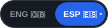
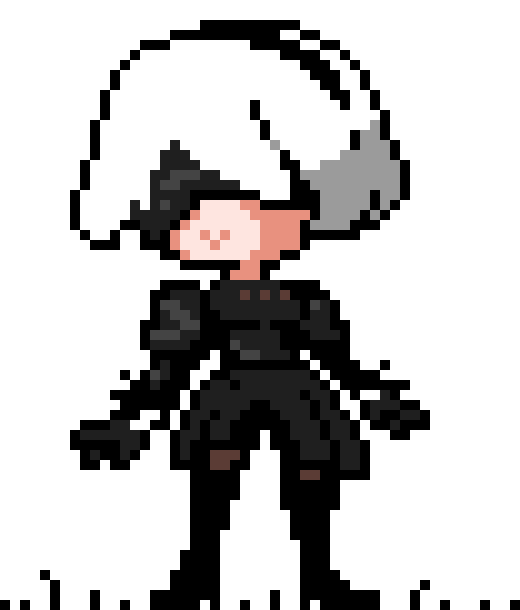

    

<h1 align="center">
    Hola, soy Raúl Medina
    
</h1>

    

    
    

<h2>
    
    <i>Sobre mí</i>
</h2>

    Soy estudiante de Ingeniería de Software en Panamá 🇵🇦, apasionado
    por el desarrollo de software, la resolución de problemas y la
    computación científica. Disfruto explorando nuevas tecnologías 🚀
    y combinando programación, matemáticas y datos para desarrollar
    soluciones innovadoras.

<ul>
    <li>🎓 Estudiante de Ingeniería de Software, finalizando mis estudios.</li>
    <li>🔬 Actualmente me interesa desarrollar proyectos científicos: transformar datos, código y curiosidad en soluciones que generen impacto.</li>
    <li>🌱 Me encanta aprender: cada nueva herramienta es un superpoder esperando a ser desbloqueado.</li>
    <li>
        📫 Puedes contactarme en:
        <a href="mailto:raulmedina.ep@outlook.es">raulmedina.ep@outlook.es</a>
    </li>
</ul>

 

<h2 align="left">
    
    <i>Habilidades & Experiencia</i>
    
</h2>

<h3>Lenguajes</h3>

    

<h3>Frameworks</h3>

    

<h3>ML / IA y herramientas</h3>

    

    
    
    
    
    
    
    

<h2>🤝 Conectemos</h2>

    
    
    
    
    

    <i>Gracias por pasar por aquí, parece que alguien sí lee estas cosas. 😄</i>

