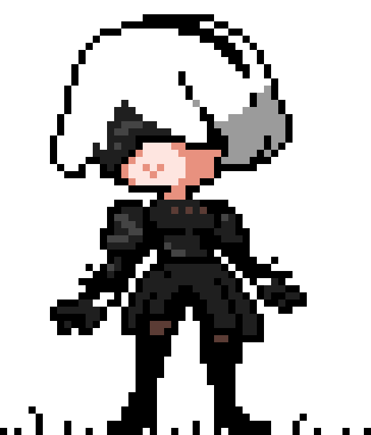

<h1 align="center">
    Hi, I'm Raúl Medina
    
</h1>

    

    
    

<h2>
    
    <i>About Me</i>
</h2>

    I am a Software Engineering student from Panama 🇵🇦, passionate
    about software development, problem-solving, and scientific
    computing. I enjoy exploring new technologies 🚀 and combining
    programming, mathematics, and data to build innovative solutions.

<ul>
    <li>🎓 Software Engineering student, finishing my studies.</li>
    <li>🔬 Currently drawn to building scientific projects: turning data, code and curiosity into things that matter.</li>
    <li>🌱 I love learning: every new tool is a new superpower waiting to be unlocked.</li>
    <li>
    📫 Reach me at:
    <a href="mailto:raulmedina.ep@outlook.es">
        raulmedina.ep@outlook.es
    </a>
    </li>
</ul>

 

<h2>
    
</h2>

<h3>Languages</h3>

    
    
    
    
    
    
    
    
    

<h3>Frameworks</h3>

    
    
    
    
    

<h3>Databases</h3>

    
    

<h3>IDE / Editors</h3>

    
    
    

<h3>ML / AI &amp; Tools</h3>

    
    
    
    
    
    
    
    

<h2>🤝 Let's Connect</h2>

    
    
    
    
    

    <i>Thanks for stopping by, so someone does read these things. 😄</i>

